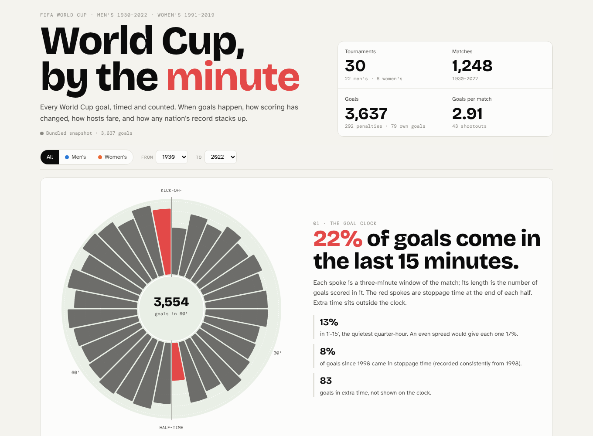
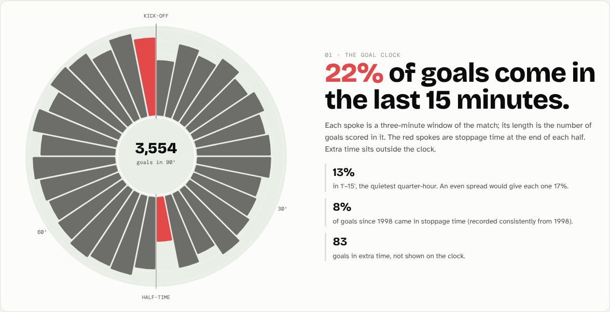

# World Cup, by the minute

**Every men's (1930–2022) and women's (1991–2019) World Cup goal, timed and counted.**
**22% of goals come in the last 15 minutes**, against 13% in the opening 15. Hosts have won 7 of 30 tournaments. Men's scoring fell from 5.38 goals a game in 1954 to 2.21 in 1990.

**[Open the live dashboard →](https://qaisbello.github.io/data-analytics/world-cup/)** · reads `data/cleaned/` from this repo on every load



## What's in it

| Panel | What it shows |
|---|---|
| **Goal clock** | Goals by three-minute window drawn as a match clock, with stoppage time as its own wedges at 45+' and 90+' |
| **Goals per match** | Every tournament, men's and women's. Click a point to focus the page on that tournament |
| **Home advantage** | How far every host went, from group exit to champions |
| **Nation explorer** | Any team's record: tournaments, W–D–L, goals and finish at every edition |
| **Records** | Highest-scoring matches and biggest margins |

Everything responds to the men's/women's switch and the year range.



## Findings

- **Goals come late.** 22% of goals in normal time are scored from the 76th minute on, including stoppage time. The opening 15 minutes are the quietest, at 13%. An even spread would give each quarter-hour 17%.
- **Stoppage time matters.** Since 1998, when added-time minutes started being recorded consistently, about 1 in 12 goals has come in stoppage time.
- **Home advantage is real.** Hosts won 7 of 30 tournaments and reached the last four 14 times. With about 21 teams per tournament on average, a random team would win roughly one in 21.
- **Scoring collapsed, then levelled off.** Men's goals per match peaked at 5.38 in 1954 and bottomed out at 2.21 in 1990, the tournament that prompted the back-pass rule. They have stayed between 2.27 and 2.71 since. Women's tournaments average 3.23.

## What I did

1. **Replaced the original data.** My first version was an Excel dashboard (kept at [`docs/img/excel-dashboard-v1.png`](docs/img/excel-dashboard-v1.png)) with no data in the repo. This version rebuilds it from the open, cited [Fjelstul World Cup Database](https://github.com/jfjelstul/worldcup), and [`src/download.py`](src/download.py) fetches it reproducibly.
2. **Cleaned and checked it.** Stage names were spelled several ways, including a "quater-finals" typo. Four replayed matches needed a decision. Stoppage-time minutes only exist consistently from 1998, so time-based claims are limited to that period. All of this is logged in [`data/cleaned/data_quality_log.csv`](data/cleaned/data_quality_log.csv).
3. **Modelled it into five tidy tables** (tournaments, goal minutes, team-by-tournament records, top matches, quality log) with [`src/build.py`](src/build.py).
4. **Built the dashboard** in D3, including the goal clock, a radial chart designed for this data.

The original version's attendance analysis isn't reproduced, because attendance isn't in the open database.

## Skills shown

Sourcing and citing open data · data cleaning and standardisation · Python (pandas) · data modelling · custom visualisation (radial "goal clock", D3.js) · cross-filtered dashboards · honest caveats about historical recording

## Power BI version

The same project as a ready-made Power BI report, in [`powerbi/`](powerbi/): a goal clock (share of goals by quarter-hour), every tournament and its host, and a nation explorer. `powerbi/tools/expected.py` recomputes the findings above and they all agree. Open `powerbi/World_Cup.pbip` in Power BI Desktop and click Refresh; it reads this repo's data from GitHub.

## Run it

```bash
pip install -r requirements.txt
python src/download.py           # fetch the raw CSVs
python src/build.py              # rebuild data/cleaned/
python src/build_dashboard.py    # rebuild dashboard/index.html
```

## Licence and credit

Data: **Fjelstul World Cup Database**, © 2023 Joshua C. Fjelstul, Ph.D., [github.com/jfjelstul/worldcup](https://github.com/jfjelstul/worldcup), [CC-BY-SA 4.0](https://creativecommons.org/licenses/by-sa/4.0/legalcode). Modified: stage names standardised and tables aggregated. Derived data is shared under the same licence (see [`DATA_LICENSE.md`](DATA_LICENSE.md)).

---
Analysis and dashboard by **Qais Adeniji-Bello** · [qaisbello.github.io](https://qaisbello.github.io) · [LinkedIn](https://www.linkedin.com/in/qais-adeniji-bello/)
